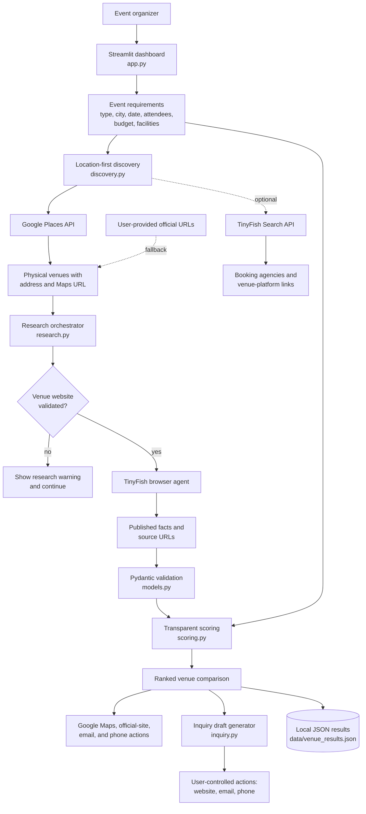

# VenueScout AI

VenueScout AI is a Streamlit application that helps event organizers discover,
research, and compare venues. It uses TinyFish browser automation to inspect
official venue websites and shows only published, source-backed information.

## The problem

Venue research is usually a manual process: searching for options, visiting
many websites, comparing incomplete capacity and amenity information, then
emailing venues for prices and availability. VenueScout AI creates a structured
shortlist while marking unsupported facts as unverified.

The application recommends venues; it does not make bookings, send email, or
guarantee availability.

## Features

- Event requirements form for event type, city/locality, attendees, budget, date, and facilities.
- Location-first discovery through Google Places, with exact addresses and Google Maps links.
- Optional, separately labelled booking-agency and venue-platform links.
- Website research with TinyFish and Pydantic-validated venue records.
- Transparent rule-based scoring for capacity, published price, and facilities.
- Evidence URLs and explicit unknown-field warnings.
- An editable enquiry draft plus direct website, email, and phone actions when public contact details are available.

## Architecture



| Layer | Responsibility | Main files |
|---|---|---|
| Presentation | Collect event requirements, show progress, compare venues, and expose user-controlled contact actions. | `app.py` |
| Discovery | Find exact physical venues through Google Places, remove duplicates by Place ID, and use supplied URLs if location search fails. | `src/venuescout/discovery.py`, `google_places_client.py` |
| Research | Validate that a candidate is a venue, browse official pages, and request structured evidence-backed facts. | `src/venuescout/research.py`, `tinyfish_client.py` |
| Validation | Normalize data and represent missing facts as `null` or unverified. | `src/venuescout/models.py` |
| Decisioning | Score capacity, published price, and requested amenities with explainable rules. | `src/venuescout/scoring.py` |
| Follow-up | Generate an editable enquiry draft; users choose whether to open Google Maps, a website, email client, or phone dialer. | `src/venuescout/inquiry.py` |
| Storage | Persist the latest successful research results locally for the MVP. | `data/venue_results.json` |

### Design boundaries

- Google Places is the first-choice source for physical location, address, Maps URL, and place identity. TinyFish is used for optional booking-provider discovery and official-website research.
- Booking agencies and venue platforms are separate intermediary links; they are never ranked as physical venues.
- Only information published on venue websites should be marked as verified, with supporting URLs retained.
- Missing capacity, prices, amenities, or availability remain unverified rather than inferred.
- The system never automatically sends email, books a venue, or makes payments.

## Demo video

[](https://youtu.be/xQ22CQIejuU)

[Watch the VenueScout AI demo on YouTube](https://youtu.be/xQ22CQIejuU)

## Setup

1. Create and activate a Python 3.10+ virtual environment.
2. Install dependencies:

   ```bash
   pip install -r requirements.txt
   ```

3. Create a `.env` file from the following template:

   ```env
   TINYFISH_API_KEY=your_key_here
   GOOGLE_MAPS_API_KEY=your_key_here
   ```

   Enable **Places API (New)** for the Google key. The app requests only the
   place fields needed for venue identity, address, maps link, contact details,
   rating, and official website.

4. Start the app:

   ```bash
   streamlit run app.py
   ```

## Testing

Run the offline unit tests with:

```bash
python -m pytest -q
```

## Limitations

- Google Places requires a configured Google Maps API key and enabled billing.
- Research quality depends on each venue's public website.
- Published prices and availability are often incomplete; those fields remain unverified until confirmed with the venue.
- The MVP ranks venues using a simple, explainable scoring system and currently does not score travel time or date availability.
- Website, email, and phone actions always require the user's final action.

## Security

Never commit `.env` or API keys. The supplied `.gitignore` excludes local
secrets, virtual environments, and generated Python cache files.
